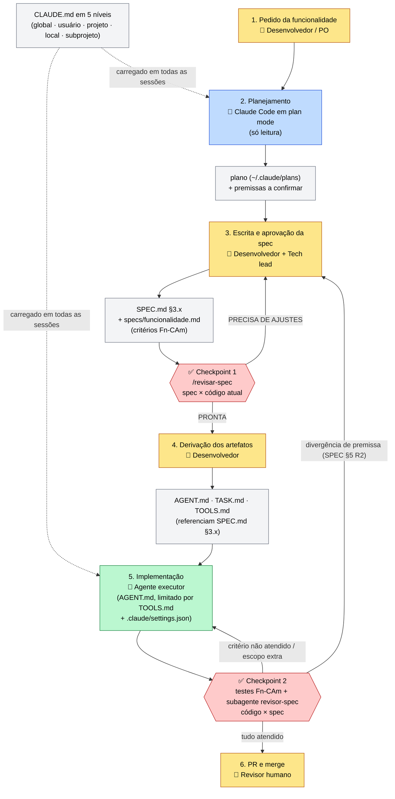

# Exercício 9: Fluxo de desenvolvimento guiado por especificação

**Para:** diretoria e liderança técnica (prova de conceito do novo processo da squad).

## 1. Visão geral

Toda funcionalidade passa por **seis etapas**. Cada etapa consome artefatos versionados que já existem neste repositório e produz um novo artefato. Duas das etapas são **checkpoints**: são o ponto em que a especificação aprovada é comparada com o que foi produzido.

## 2. Etapas, artefatos e consumidores

| # | Etapa | Quem executa | Consome | Produz | Exemplo real neste TP |
|---|---|---|---|---|---|
| 0 | Base de contexto (sempre ativa) | — | — | `CLAUDE.md` em 5 níveis | [`CLAUDE.md`](../CLAUDE.md), [`backend/CLAUDE.md`](../backend/CLAUDE.md), [`scripts/migracao/CLAUDE.md`](../scripts/migracao/CLAUDE.md) (Ex. 3) |
| 1 | Pedido | **Desenvolvedor humano** | Necessidade do negócio | Descrição curta e regras propostas | "cancelamento com reembolso: 24h = 100%, 2h = 50%" |
| 2 | Planejamento | **Claude Code em plan mode** | `CLAUDE.md` e o código atual (só leitura) | Plano com as premissas a confirmar | [`evidencias/ex06-plano-plan-mode.md`](evidencias/ex06-plano-plan-mode.md) (sessão `870d4f97`) |
| 3 | Spec aprovada | **Desenvolvedor + tech lead** | O plano | `SPEC.md §3.x` + `specs/*.md` com os critérios `Fn-CAm` | [`SPEC.md`](../SPEC.md), [`specs/cancelamento-reembolso.md`](../specs/cancelamento-reembolso.md) (Ex. 6 e 7) |
| ✅1 | **Checkpoint 1: spec × código** | **Skill `/revisar-spec`** (Claude Code), com o veredito lido por um humano | A spec e o código atual | Tabela de lacunas e o veredito | [`evidencias/ex09-revisar-spec.md`](evidencias/ex09-revisar-spec.md) |
| 4 | Derivação | **Desenvolvedor humano** | `SPEC.md §3.x` | `AGENT.md`, `TASK.md`, `TOOLS.md` | [`AGENT.md`](../AGENT.md), [`TASK.md`](../TASK.md), [`TOOLS.md`](../TOOLS.md) (Ex. 8) |
| 5 | Implementação | **Agente executor** (Claude Code com o papel de `AGENT.md`) | `TASK.md` (o que fazer), `AGENT.md` (limites), `TOOLS.md` + `.claude/settings.json` (o que pode usar), `SPEC.md §3.x` (regras) | Código e testes `test_caN_*` | — (próxima etapa da disciplina) |
| ✅2 | **Checkpoint 2: código × spec** | **Testes automatizados** + **subagente `revisor-spec`** com contexto isolado | O diff, `SPEC.md §3.x` e a suíte de testes | Critério a critério: atendido / não atendido / sem teste / escopo extra | `.claude/agents/revisor-spec.md` |
| 6 | Merge | **Revisor humano** | O PR com o relatório de saída do `TASK.md` e o relatório do revisor | Merge ou pedido de ajuste | — |

## 3. Justificativa técnica

O fluxo reduz o risco de o código divergir da especificação porque **a spec deixa de ser um documento que se lê uma vez e passa a ser uma entrada que é verificada em todas as etapas.** Isso se apoia em quatro mecanismos.

1. **Rastreabilidade obrigatória entre critério e teste (checkpoint 2).** Todo critério de aceite tem um ID (`F3-CA5`, por exemplo), e o `TASK.md` só considera a tarefa pronta quando existe um teste com esse ID no nome que passa. O subagente `revisor-spec` percorre a lista de critérios de `SPEC.md §3.3` e marca cada um como *atendido / não atendido / sem teste*. Ele também aponta *escopo extra*, ou seja, comportamento implementado que a spec não pede (o risco R1). Esse é o **ponto específico** em que a divergência aparece antes do merge. O revisor roda em um **contexto isolado** (estratégia *Isolate* do Ex. 4): não herda as suposições da sessão que escreveu o código e lê só a spec e o diff. Ele não consegue "concordar" com uma decisão que o implementador tomou no meio da conversa, porque essa decisão nunca entrou na janela dele.

2. **A divergência é encontrada antes do código (checkpoint 1).** O plan mode lê o código real sem poder alterá-lo, e o `/revisar-spec` compara a spec com o código **antes** de qualquer implementação. Neste TP isso aconteceu de fato, em três momentos ([`evidencias/ex09-revisar-spec.md`](evidencias/ex09-revisar-spec.md)):
   - O **plan mode** descobriu que não existe a entidade "consulta" (o risco R2), e isso virou a §2 da spec.
   - A **primeira rodada** do `/revisar-spec` (sessão `34d4e4a3`, veredito *PRECISA DE AJUSTES*, 14 achados) encontrou uma afirmação da spec que o código desmentia. A spec dizia que o relatório de ocupação "passa a ver o slot livre de novo", mas `relatorio_ocupacao.py:24` cria uma agenda nova, sem reservas. Também encontrou que o `TOOLS.md` dizia que a restrição de escrita estava no `settings.json` e ela não estava.
   - A **segunda rodada** (sessão `60e352f9`) encontrou um risco de **estorno em dobro**: um retry depois de um timeout, já em outra faixa de prazo, geraria outra chave de idempotência.

   Nenhuma dessas divergências chegou ao código. Todas viraram mudanças na spec (v1.0 → v1.1 → v1.2), no `TOOLS.md` e no `settings.json` antes da implementação. A spec só passa para a etapa 4 depois da aprovação do tech lead, registrada no cabeçalho.

3. **Os limites são aplicados pela ferramenta, não só descritos no texto.** O `TOOLS.md` corresponde ao `.claude/settings.json` e diz, linha a linha, o que é **imposto** e o que é **convenção**:
   - `git push`, `--aplicar` e acesso à web estão em `deny`;
   - `git commit`, a edição dos módulos e testes que já existem, de `config/` e das specs estão em `ask`. O agente não consegue "resolver" uma divergência mexendo em configuração, apagando um teste ou publicando o código sem um humano, porque essas ações estão bloqueadas ou pedem confirmação.

4. **Referência em vez de cópia.** `AGENT.md`, `TASK.md` e `TOOLS.md` apontam para `SPEC.md §3.3` e não repetem as regras. Se o prazo de reembolso mudar, ele muda em um único lugar, e a próxima execução do agente já lê a regra nova. Não há uma cópia antiga em outro arquivo para ele seguir por engano. Isso evita o mesmo tipo de *context clash* que o Exercício 4 reproduziu, só que agora entre documentos.

Quando o checkpoint 2 encontra uma divergência, o caminho de volta está no diagrama: um critério não atendido volta para a implementação, e uma premissa errada volta para a spec. Em nenhum dos casos o código é mergeado com a spec dizendo outra coisa, e é isso que a regra "a spec vence por padrão" (`SPEC.md §5`) garante.
